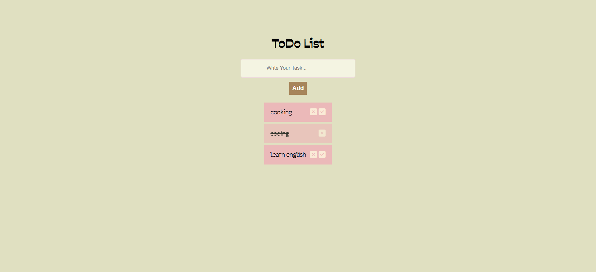

# 📝 React ToDoApp

A simple and engaging project for managing tasks using HTML, CSS, JavaScript, and React.  
Each task can be added, deleted, and marked as completed.

---

## 🖼️ Preview

---

## 📦 Features

- ✅ Responsive design
- 🎨 Modern and clean UI
- ✔ Add, delete, and mark tasks as completed
- 💡 Clean and readable HTML/CSS structure
- ✔ Built with React

---

## 🛠️ Built With

- HTML5
- CSS3
- JavaScript
- React

---

## Developer

💻 Created by Sobhan Eyvazipour
